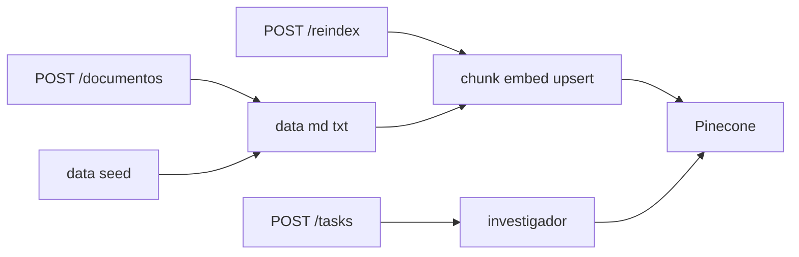
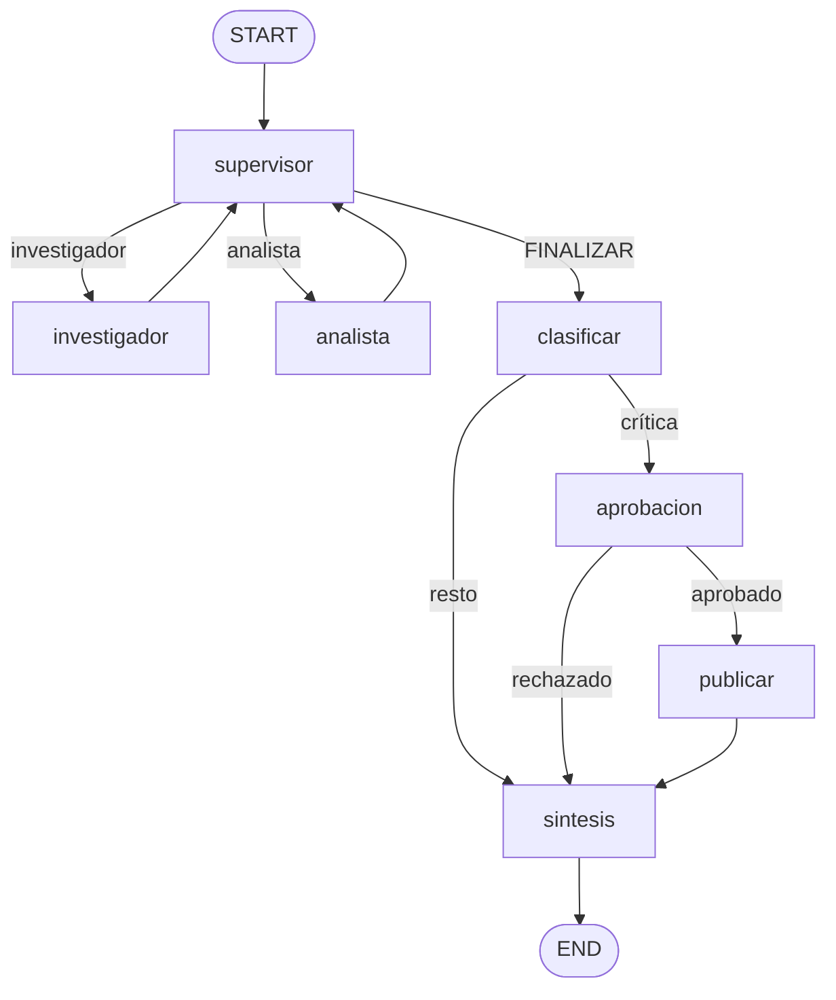

# The Intelligence System

Sistema de IA completo que consolida las pre-entregas de los **módulos 6 y 7**, con RAG sobre **Pinecone** (módulo 4) y carga de documentos por API.

Dominio seed: inteligencia de producto sobre el **Nova X**. El conocimiento real es lo que haya en `data/` al arrancar **más** lo que se suba por `POST /documentos`.

## Arquitectura

| Capa | Qué hace |
| --- | --- |
| **API** (`app/main.py`) | FastAPI + Pydantic. Jobs, HITL, documentos e indexación. |
| **Worker** (`app/worker.py`) | Consume la cola Redis y ejecuta el grafo. |
| **Grafo** (`app/graph.py`) | Supervisor → investigador / analista → clasificación HITL → síntesis. |
| **RAG** (`app/rag/`) | Chunking, embeddings Ollama, upsert/query en Pinecone. |
| **Agentes** (`app/agents/`) | Investigador (busca en Pinecone) y analista (sentimiento + margen). |
| **Checkpointer** | `AsyncRedisSaver`: los hilos sobreviven al reinicio del servidor. |
| **Observabilidad** | OpenInference → Phoenix. |

Toda la comunicación con LLMs, embeddings y Redis usa `async`/`await` (o `asyncio.to_thread` para el SDK de Pinecone). Modelos, índice y namespace salen de variables de entorno.



## Diagrama del grafo de agentes



## Arranque en una instrucción

1. Copiá `.env.example` → `.env` y completá **`PINECONE_API_KEY`**.
2. Ejecutá:

**Windows:**

```powershell
.\run.ps1 start   # o solo .\run.ps1
.\run.ps1 stop    # baja Redis + Phoenix + API
```

**Linux / macOS:**

```bash
chmod +x run.sh && ./run.sh
```

El script:

1. Valida `.env` y `PINECONE_API_KEY`
2. Crea/actualiza el venv
3. Levanta **solo Ollama en el host** (`levantar.py --solo-ollama`) y asegura modelos
4. Corre `docker compose up --build -d` (**Redis + Phoenix + API** en Docker)

Phoenix no se duplica: va en Compose. Ollama queda afuera para usar GPU/DirectML.

Al arrancar, si el namespace de Pinecone está vacío y hay archivos en `data/`, la API indexa el seed (`novax-resenas.md`, `novax-ficha.md`).

| Servicio | URL |
| --- | --- |
| API (Swagger) | http://127.0.0.1:8000/docs |
| Phoenix | http://127.0.0.1:6006 |
| Ollama (host) | http://127.0.0.1:11434 |
| Redis | `localhost:6379` |

Bajar el stack: `docker compose down`.

## Conocimiento: seed + API

| Método | Ruta | Qué hace |
| --- | --- | --- |
| `GET` | `/documentos` | Lista archivos en `data/` y conteo de chunks en Pinecone |
| `POST` | `/documentos` | Sube `.md`/`.txt`, los guarda en `data/` y **reindexa cada archivo al momento** en Pinecone |
| `POST` | `/reindex` | Vacía el namespace y reindexa **todo** `data/` (usar si moviste archivos a mano) |

Al subir con `POST /documentos` no hace falta llamar a `/reindex`: por cada archivo se borran los chunks previos con el mismo nombre (`source`) y se vuelven a embebir/upsert. La respuesta incluye `detalle` (`nombre` + `chunks` por archivo), `chunks_nuevos` y `chunks_totales`.

Formatos: solo `.md` o `.txt` en UTF-8 (máx. ~2 MB por archivo).

### Ejemplos de carga (`curl`)

Un archivo:

```powershell
curl.exe -X POST "http://127.0.0.1:8000/documentos" `
  -F "archivos=@.\data\novax-faq.md"
```

Varios a la vez (cada uno se reindexa al subir):

```powershell
curl.exe -X POST "http://127.0.0.1:8000/documentos" `
  -F "archivos=@.\data\novax-faq.md" `
  -F "archivos=@.\data\novax-guia-soporte.md" `
  -F "archivos=@.\data\novax-resenas-ampliadas.md" `
  -F "archivos=@.\data\novax-politica-precios.md" `
  -F "archivos=@.\data\novax-comparativa.md"
```

Listar archivos en disco + chunks en Pinecone:

```powershell
curl.exe "http://127.0.0.1:8000/documentos"
```

Reindexar todo el directorio `data/` (wipe del namespace):

```powershell
curl.exe -X POST "http://127.0.0.1:8000/reindex"
```

También podés usar Swagger: http://127.0.0.1:8000/docs → `POST /documentos`.

## Validación: upload + 5 pruebas + HITL

```powershell
.\.venv\Scripts\python.exe correr_carga.py
```

1. Sube `data/prueba-upload.md` por API y consulta el token indexado  
2. Corre **5 consultas concurrentes** sobre Nova X  
3. Corre la tarea crítica con **aprobación humana**

Informe: `trazas/carga.json`. En Phoenix, proyecto `intelligence-system`, span `orquestador.consulta`.

Capturas de referencia en `screenshots/`.

## API de tareas

| Método | Ruta | Qué hace |
| --- | --- | --- |
| `GET` | `/health` | API, Redis, Pinecone y cantidad de chunks |
| `POST` | `/tasks` | Encola la consulta → `job_id` (202) |
| `GET` | `/tasks/{job_id}` | Estado del job |
| `POST` | `/tasks/{job_id}/approve` | Reanuda una tarea crítica |
| `GET` | `/conversations/{thread_id}` | Checkpoint del hilo en Redis |

## Estructura

```
moduloFinal/
├── app/
│   ├── main.py
│   ├── graph.py
│   ├── worker.py
│   ├── hitl.py
│   ├── llm.py
│   ├── schemas.py
│   ├── observability.py
│   ├── agents/          # investigador, analista
│   └── rag/             # chunks, embeddings, ingest, pinecone
├── data/                # seed + documentos subidos
├── docker-compose.yml
├── run.ps1 / run.sh
├── correr_carga.py
└── requirements.txt
```

## Configuración

Variables clave en `.env` (ver `.env.example`):

- `PINECONE_API_KEY`, `INDEX_NAME`, `PINECONE_NAMESPACE`
- `LLM_PROVIDER=ollama|gemini`, `EMBEDDING_PROVIDER=ollama|google`

### Gemini sin Ollama

Con `LLM_PROVIDER=gemini`, los embeddings usan Google por defecto. `run.ps1` no levanta Ollama.

```env
LLM_PROVIDER=gemini
EMBEDDING_PROVIDER=google
GOOGLE_API_KEY=tu_clave
GEMINI_MODEL=gemini-2.0-flash
INDEX_NAME=intelligence-system-gemini
```

### Híbrido: Gemini + embeddings Ollama

```env
LLM_PROVIDER=gemini
EMBEDDING_PROVIDER=ollama
INDEX_NAME=intelligence-system
```

## Origen

- **Módulo 4:** Pinecone serverless + chunking/embeddings  
- **Módulo 6:** orquestador jerárquico  
- **Módulo 7:** API de producción, Redis, Phoenix, HITL  
- **proyecto-rag-local:** `POST /documentos` + `POST /reindex`
